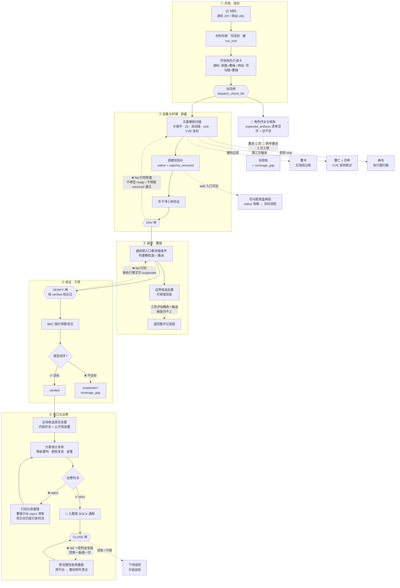

<div align="center">

# 🛡️ 曹操

**白盒源码审计多代理 skill 包 —— AI 按九角色流水线读源码挖 0day，机械闸防它编造**

[](#-工作流)
[](https://www.python.org/)
[](https://nodejs.org/)
[](SKILL.md)
[](#%EF%B8%8F-安装)

**白盒源码审计 · 九角色 · 三段闸 · 零伪造 · 可粘贴复核**

[特色](#-特色不信任-ai) · [工作流](#-工作流) · [角色](#-九角色) · [安装](#%EF%B8%8F-安装) · [依赖](#-依赖)

</div>

---

装进 AI 编码代理宿主后，把一份**源码 ZIP** 交给 agent，它就会按本包的规则流水线完成白盒审计——五套硬账扫描、越权链审看拼接条件、危险 sink 拉起实测、组件 CVE 双岗核对——产出**带完整证据链、第三方可整段粘贴复核**的漏洞报告（DOCX）。部署型源码自动起双拓扑配套黑盒验证；纯网站审计也支持，但本包的主场是白盒。

部分沿革与判例文件未随仓库发布，见 [CHANGELOG.md](CHANGELOG.md)。

## 🔥 特色：不信任 AI

AI 审计最大的坑不是找不到洞，是**编**：编扫描账、编截图、编「已通过」。本包的机械闸全是为堵这个建的——

| 机制 | 一句话 |
|---|---|
| 🔒 回执不可信 | 「闸已过」不算数，下游必须本地重跑 `hard_gate.py` 核对；手写回执按伪造论处 |
| 🧬 闸也防篡改 | 工具哈希基线外发留底，信任根放在 AI 写不到的存储（已发消息 + 用户抄录值） |
| 🗑️ 账本反垃圾 | 五套扫描账按条抽验，抽 3 条 2 条落空 = 整账作废重扫 |
| ✅ 闭环才 verified | SQL 要库侧真值比对、越权要他者真实数据、RCE 要真实执行效果 |
| 📋 抽验锚点 | 每份报告附 3 条可粘贴复跑的原样命令，随手一条定真伪 |
| 📉 降级留痕 | 给洞降级必须写 ≥20 字理由，缺理由闸直接 fail |
| 🩸 最丑自报 | 收口必须自报证据链最弱 3 处，禁「全绿」收口 |
| 👁️ 发现者不自判 | 分身独立复核出卷，发现者不给自己签字 |

这套闸经内部多轮「摸鱼 AI vs 闸」攻防迭代，已知绕过路径清零。

## 🔁 工作流



打回纪律贯穿全程：**闸 fail 不是终点是回路**——env fail 打回郭嘉（不得谎报 ready）、verify fail 打回补证据（缺执行事实只能 suspected）、close fail 一轮列全所有毛病、修完整张账再重跑（禁修一条跑一次）；分身出卷判 reject 打回分身自己重做，曹操只出问题清单不代改；子代理按 `expected_artifacts` 清单收账，没齐就是没干完——重派 1 次、拆半重派、3 次上限后走失败账，禁止把「派过」记成「做过」。郭嘉收话前还须自跑 env dry-run 消化自己的条目，把毛病拦在闸前。

## 👥 九角色

| 角色 | 职责 | 上场时机 |
|---|---|---|
| 🔍 **郭嘉** | 源码采集、双拓扑搭建、五套硬账扫描 | 源码场开局 |
| 🎖️ **曹操** | 总编排 + 链审，签 verified、收口 | 全场常驻 |
| 🌐 **司马懿** | 黑盒两段（未登录观察 + 登录态深挖） | 网站场 / web 入口可达 |
| 🎯 **于禁** | BEC 预算下发包验证 | 首条漏洞验证前 |
| 🧱 **曹冲** | WAF / Filter / 验证码防护实测绕过 | 撞到过滤当回合 |
| 🧬 **曹仁** | 组件 CVE 本地适用性核对（file:line） | 第三方版本出现 |
| 📡 **刘晔** | NVD / GHSA 公开库独立查询留原件 | 第三方版本入账 |
| ⚙️ **典韦** | 未解析终点、危险 sink 执行面扫描 | 出现危险 sink |
| 📄 **曹操分身** | 独立复核 + 出卷判决 + DOCX 排版 | 首条 verified 后 |

角色产物按目录号落位（`01-guo-jia/` ~ `09-si-ma-yi/`）。

## ⚙️ 核心机制

角色不是各干各的，协作与扩权全部受机制约束：

| 机制 | 怎么运转 |
|---|---|
| 🔧 **造工具审批制** | 郭嘉每场必做「工具覆盖评估」（抽样读代码核包内工具覆盖面）：有缺口 → **必须自写补充工具补上**，复制/换皮/空壳凑数 = 没做退回；无缺口 → 请示豁免（原因/证据/理由三样齐）。曹操核对两步——先抽 1-2 份声称读过的文件**核实没编造**，再核结论。未批工具产物一律 `candidate_only` 不顶硬账；walker 零命中、规则盲区形态等**被动触发**当回合上报。任何工具**不写 exploit**，只做采集/解析/比对/复核 |
| 💰 **BEC 探针预算** | 于禁按预算发包：用量 ≥80% 且链仍活 → 曹操当回合自动预签下一档（不让续签成串行卡点）；配额见底必须**当回合上报**剩余面清单，禁静默收口；每条挂账写「预计 N 发可定谳」，4 发能定谳的不许躺过夜 |
| 🙈 **司马懿隔离** | 黑盒角色**不收郭嘉答案**：禁读源码采集目录、禁拿解密链/候选索引/万能密码线索——白盒答案塞黑盒 = 整场作废级违规，保证黑盒发现独立可信 |
| 🧬 **双拓扑** | 同一份源码同时起两套环境：native（验证码保留，只观察登录门）+ captcha_removed（去干净三枪验证后，全套业务小跑与登录态深挖在这套打）；副本改动逐文件登记、闸做全树差集对账防夹带 |
| 📠 **猝死三件套** | 额度/断流随时会死：角色濒险写断点交接件（新实例读表续命）；主会话第一声报错先落遗言件；同一角色 3 次失败走失败账 + coverage_gap，禁止无声放弃也禁止无限重试 |
| 🔁 **挂账与升链** | 收口待办自动提级（下场无更高优先面即升首发）；每场收口后链审必过升链方向（同对象写面未测 / SSRF 未打内网 / XSS 未窃凭据），按组执行共享环境、测完一组关一组容器 |
| 🔑 **凭据纪律** | 凭据值全场只许落两处指定文件，其余一律引用指针；正式报告 8 块正文**不脱敏写实值**（对审核负责），内部账不复制；收口跑凭据外泄扫描 |
| 🚫 **五套硬账互不顶** | 关键字 / JS 清单 / 自动链 / sink 运行态 / CVE 坐标五套账各是各的——swagger 顶不了 JS 清单、链审 grep 顶不了关键字账、walker 命中只是 candidate；「一套做了」免除不了其余四套 |

## 🛠️ 安装

```bash
git clone https://github.com/35789-gh/caocao-skill.git
```

- 仓库根的 `SKILL.md` 就是 skill 入口（常驻只有这一份，角色卡 / 闸页按「按需读」路由打开）
- 按宿主约定放入 skills 目录（如 ZCode `~/.zcode/skills/caocao/`、Claude Code `~/.claude/skills/caocao/`），或直接把本包路径点名给 agent
- 触发：对 agent 说「用 cao-cao 审计 \<源码路径 / 网站地址\>」；也可不当 skill，当审计流程规范 + 检查器工具集直接读用

**检查器**：`dispatch_check_lite.py`（派活闸）· `hard_gate.py --phase env|verify|close`（作业硬闸）· `check_finding.py`（写时自检）· `auto_chain_scan.py`（walker）· `hybrid_discovery.py`（召回）· `js_unpack.py`（前端解包）· `js_endpoint_scan.py`（接口清单素材）· `credential_scan.py`（凭据外泄扫描）

## 📦 依赖

| 依赖 | 说明 |
|---|---|
| Python 3.8+ | **全部检查器/扫描器纯标准库实现，零第三方依赖** |
| Node.js（可选） | `vis-tools/` 浏览器工具族（CDP 截图/录屏）；`cd scripts/vis-tools && npm install` |
| DOCX 出卷 | 分身用 python-docx 生成（`pip install python-docx`） |
| 视觉复核（可选） | OpenAI 兼容识图服务：环境变量 `CAOCAO_FAKER_BASE` + provider 配置（`CAOCAO_PROVIDER_CONFIG` 可覆盖） |
| 向量召回增强（可选） | 内置 lexical 版已满足闸要求；如需向量召回，自备 v7 包后在 `tools.json` 的 `v7_root` 登记 |

```
SKILL.md        protocol/     roles/       references/
scripts/        templates/    tests/       draft/
```

## ⚖️ 声明

- 仅用于**已授权**的安全审计（SRC、授权渗透、自有代码审计）；框架不含攻击载荷，工具只做采集/解析/比对/复核
- 正文「批N / era」编号指向未随仓库发布的沿革文件，保留措辞以不改动规则语义
